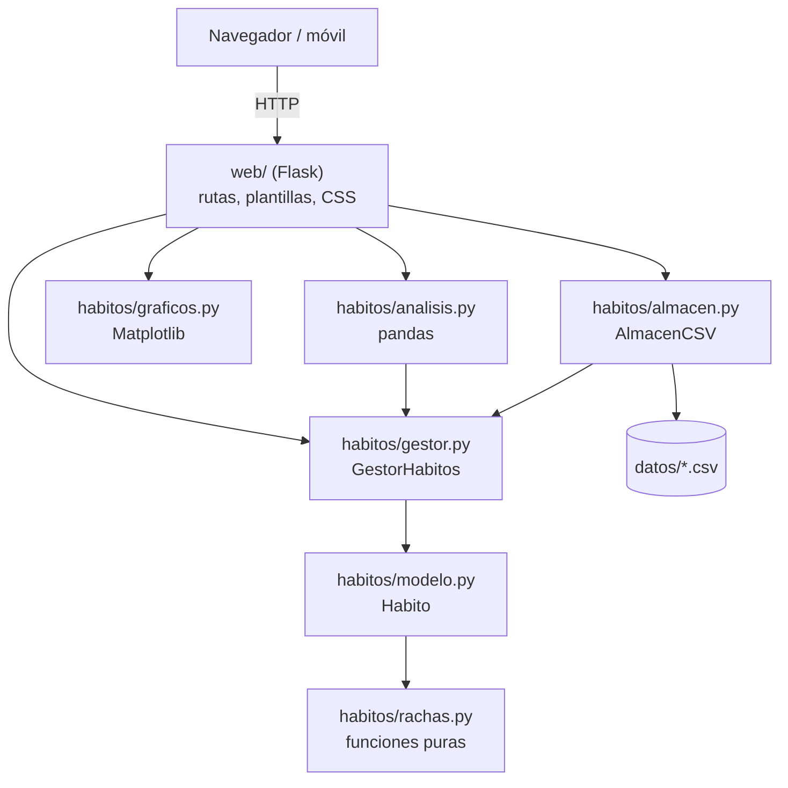
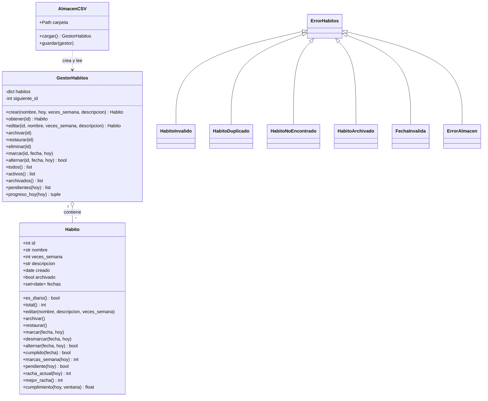

# Arquitectura y decisiones de diseño

## 1. Visión general

La aplicación se organiza en capas. Cada capa solo conoce a las que tiene debajo.



**Regla de oro:** el paquete `habitos` no importa Flask ni usa `print`/`input`. Toda la lógica se
puede probar sin servidor web y reutilizarse con otra interfaz (consola, API, app móvil…).

## 2. Diagrama de clases



- **Composición con delegación:** el gestor guarda los hábitos y se ocupa de lo que afecta al
  *conjunto* (identificadores, nombres repetidos, listados, progreso de hoy). Todo lo que concierne a
  *un* hábito (marcar, rachas, cumplimiento) lo hace el propio `Habito`.
- **Estado siempre válido:** `Habito` valida sus datos al crearse (`__post_init__`) y al editarse
  (`editar` valida antes de asignar, así un error no deja el objeto a medias).
- **`hoy` como parámetro:** ninguna función del núcleo llama a `date.today()` por dentro. Se pasa
  `hoy` explícitamente, lo que hace los tests deterministas (el 26/11/2026 siempre es jueves).

## 3. Jerarquía de excepciones

```
ErrorHabitos
├── HabitoInvalido      datos que incumplen las reglas (nombre vacío, veces fuera de 1–7…)
├── HabitoDuplicado     ya existe un hábito activo con ese nombre (sin distinguir mayúsculas)
├── HabitoNoEncontrado  el identificador no existe  → la web responde 404
├── HabitoArchivado     intentar marcar un hábito archivado
├── FechaInvalida       fecha futura o con formato incorrecto
└── ErrorAlmacen        CSV ilegible o corrupto  → la web muestra el motivo, nunca una traza
```

El núcleo **lanza**; la capa web **captura** y decide cómo mostrarlo (mensaje de aviso, 404…).
Los `try` son cortos y el almacén encadena la causa original con `raise ... from e`.

## 4. Reglas de dominio

### Frecuencia y rachas

| Frecuencia | Racha cuenta… | Se mantiene viva si… |
|------------|---------------|----------------------|
| Todos los días (7/semana) | **días** consecutivos | hoy está marcado, o hoy aún no pero ayer sí |
| 1–6 veces por semana | **semanas** consecutivas (lunes–domingo) que alcanzan el objetivo | la semana en curso está cumplida, o aún no pero la anterior sí |

*Ejemplo:* un hábito de 3 veces por semana, con 3 marcas la semana pasada y 1 esta semana (jueves),
tiene racha de 1 semana: esta semana todavía puede completarse.

### Cumplimiento (últimos 28 días)

```
días_considerados = min(28, días desde la creación)
esperadas         = veces_semana × días_considerados / 7
cumplimiento      = min(1, marcas en esos días / esperadas)
```

Un hábito recién creado no se penaliza por los días anteriores a existir.

### «Hoy toca»

Un hábito semanal cuyo objetivo ya se cumplió esta semana deja de contar en el progreso del día:
hoy toca descansar. Si lo marcas igualmente, sigue contando.

### Otras reglas

- No se puede marcar una fecha futura ni un hábito archivado.
- Marcar un día anterior a la fecha de creación adelanta `creado` (así el cumplimiento se mide desde
  que realmente empezaste).
- Los nombres no se pueden repetir entre hábitos activos (un nombre archivado sí se puede reutilizar).

## 5. Persistencia

Dos ficheros CSV en `datos/` (UTF-8):

`habitos.csv`

| Columna | Ejemplo |
|---------|---------|
| id | `1` |
| nombre | `Leer 20 minutos` |
| descripcion | `Antes de dormir` |
| veces_semana | `7` |
| creado | `2026-08-28` |
| archivado | `0` / `1` |

`registros.csv`: una fila por día cumplido (`habito_id`, `fecha`), ordenada por hábito y fecha.

Decisiones:

- **CSV en vez de base de datos:** es lo visto en el curso, se puede abrir con una hoja de cálculo
  y el contenido ordenado da diffs limpios en git.
- **Escritura atómica:** se escribe en `*.csv.tmp` y se renombra con `os.replace`; un fallo a mitad
  no deja un CSV a medias.
- **Sin estado global en la web:** cada petición carga los CSV, aplica el cambio y guarda. Es simple,
  fácil de probar y correcto aunque haya varios procesos. Con miles de hábitos habría que pasar a SQLite.
- **Validación al leer:** una fila corrupta produce `ErrorAlmacen` con el fichero y la línea.

## 6. Análisis de datos (pandas)

`analisis.registros_df` convierte el gestor en un DataFrame con una fila por día cumplido. A partir
de ahí todo son operaciones de columna, sin recorrer filas:

| Función | Técnica |
|---------|---------|
| `actividad_diaria` | `groupby("fecha").size().reindex(date_range, fill_value=0)` |
| `registros_por_dia_semana` | `value_counts().reindex(range(7))` |
| `registros_por_semana` | columna `semana` (lunes) + `groupby` + `reindex` |
| `matriz_semanal` | actividad diaria → `reshape(semanas, 7).T` + máscara para los días futuros |
| `tabla_habitos` / `indicadores` | agregaciones y ordenación estable |

Los gráficos (`graficos.py`) usan el backend `Agg` de Matplotlib, se dibujan en memoria y se incrustan
en la página como PNG en base64 con fondo transparente. Siguen la paleta neón de la interfaz (cian, rosa, lima)
y dibujan cada barra con un halo translúcido para dar efecto de resplandor.

## 7. Capa web

| Ruta | Método | Función |
|------|--------|---------|
| `/` | GET | Pantalla «Hoy» |
| `/habitos` | GET | Lista de hábitos activos y archivados |
| `/habitos/nuevo` | GET, POST | Crear |
| `/habitos/<id>` | GET | Detalle: cifras, calendario y mapa de calor |
| `/habitos/<id>/editar` | GET, POST | Editar |
| `/habitos/<id>/alternar` | POST | Marcar/desmarcar un día (`fecha`, `next`) |
| `/habitos/<id>/archivar` · `restaurar` · `eliminar` | POST | Gestión |
| `/estadisticas` | GET | Estadísticas |
| `/api/habitos`, `/api/habitos/<id>`, `/api/resumen` | GET | API JSON |
| `/manifest.webmanifest` | GET | Manifiesto para añadir a la pantalla de inicio |

Detalles:

- **Patrón Post/Redirect/Get** tras cada acción, para que recargar la página no repita la operación.
- **Redirecciones seguras:** el campo `next` solo se acepta si es una ruta interna (`/...`, nunca `//` ni URL absolutas).
- **Plantillas con escape automático** de Jinja2: un nombre de hábito como `<script>` se muestra como texto.
- **Accesibilidad:** botones con `aria-label` y `aria-pressed`, `aria-current` en la navegación, foco visible y `prefers-reduced-motion`.
- **Mobile-first:** una columna, botones táctiles de 54 px, barra de navegación inferior flotante y `safe-area-inset` para móviles con notch.
- **Estética cyber Y2K:** todo el diseño sale de variables CSS (`--cian`, `--rosa`, `--lima`…) en `web/static/style.css`: rejilla y brillos de fondo con `radial-gradient`, tarjetas de cristal con `backdrop-filter`, botones «gel» con degradados de corte duro y animaciones desactivadas con `prefers-reduced-motion`.
- **`create_app(carpeta_datos, hoy)`:** factoría que permite inyectar la carpeta de datos y el «hoy» en los tests.

## 8. Estrategia de pruebas

| Fichero | Qué comprueba |
|---------|---------------|
| `test_rachas.py` | Rachas de días y semanas, casos límite (hoy sin marcar, huecos, semana en curso) |
| `test_modelo.py` | Validaciones, marcar/desmarcar, archivado, cumplimiento, pendientes |
| `test_gestor.py` | Ids, duplicados, edición, eliminación, progreso de hoy |
| `test_almacen.py` | Ida y vuelta, CSV corruptos (fichero y línea en el error), caracteres especiales |
| `test_analisis.py` | DataFrames, series con ceros, matriz del mapa de calor, tablas e indicadores (también con datos vacíos) |
| `test_graficos.py` | Cada gráfico devuelve un PNG válido, incluso sin datos |
| `test_web.py` | Flujos completos con el cliente de Flask, errores, 404, API, escape de HTML, redirecciones |
